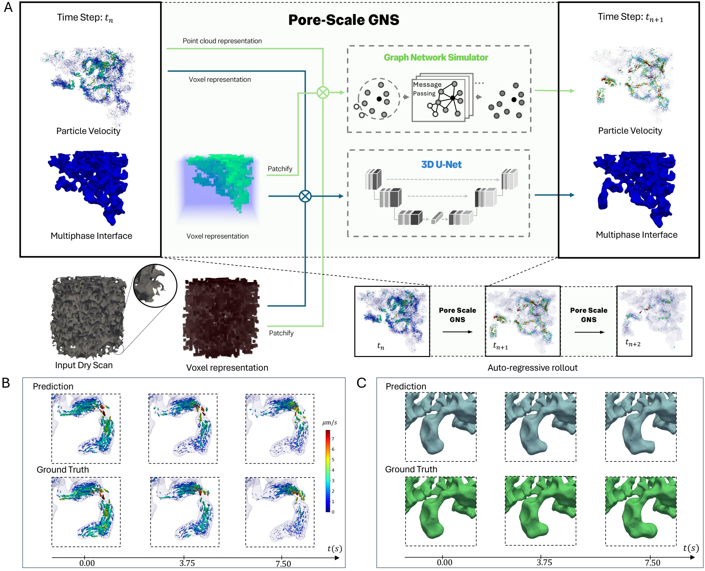

# Pore-Scale GNS

Coupled graph network and 3-D U-Net that advance pore-scale two-phase flow one CT frame (0.25 s) at a time:
the graph network predicts the tracer velocities, the U-Net the non-wetting phase.



Figure 1 of *Learning Pore-scale Multiphase Flow from 4D Velocimetry*: (A) one step of the coupled model,
(B) predicted and measured tracer velocities, (C) predicted and measured interface.

## Layout

```
pore_gns/
├── constants.py      units and grid conventions: DS, MARGIN, RADIUS, HISTORY, PATCH
├── data/
│   ├── grid.py       subsample, crop, load_rock, extract_patches, velocity_grid
│   ├── graph.py      radius_edges
│   ├── tracers.py    TracerGraphs: tracer CSV -> one graph per frame
│   └── phases.py     PhaseFrames: phase frames and velocity grids -> U-Net pairs
├── models/
│   ├── gns.py        GNS (encode-process-decode on the tracer graph), load_gns
│   └── unet.py       UNet, fold_bn
├── rollout.py        State, Rollout: one coupled step
├── inputs.py         synthetic, measured: the state a rollout starts from
├── metrics.py        dice
└── demo.py           timed rollout, Dice against measured frames
scripts/figures.py    the figures below, from a measured rollout
docs/                 framework.{pdf,png} (paper Figure 1), rollout.png, slice.png
```

The dataset classes and the rollout share the three primitives `radius_edges`, `extract_patches` and
`velocity_grid`, so each quantity has one definition. Parameter names match the original checkpoints.

## Run

```bash
pip install -e .
pore-gns-demo                                                                  # random inputs at the size of Exp. alpha, random weights
pore-gns-demo --data <experiment> --gns <gns.pt> --stats <stats.pt> --unet <unet.pth>   # measured frames, trained weights
python scripts/figures.py --data <experiment> --gns <gns.pt> --stats <stats.pt> --unet <unet.pth>   # needs matplotlib
```

`python -m pore_gns.demo` is the same as `pore-gns-demo`. An experiment folder holds `velocity.csv`
(frame, particle, z, y, x, vz, vy, vx), `rock.tif` and `tif_view/*_<frame>.npy`, the phase at grid resolution.

```python
from pore_gns import Rollout, UNet, load_gns, measured

state, frames = measured("alpha_073", t=150, dev="cuda")
roll = Rollout(load_gns("gns.pt", "stats.pt").cuda(), unet, state)
v, p_next, phase = roll.step()   # v_t, p_{t+1}, phase_t
```
